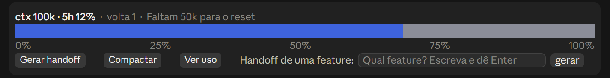
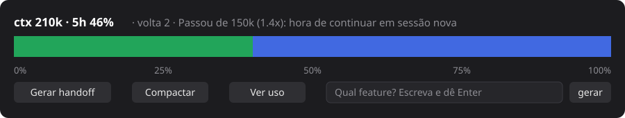
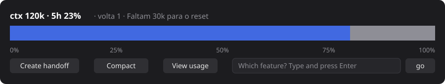

# context-coach

Uma faixa permanente acima do prompt do Claude Code que mostra, em uma barra de largura total, quanto do contexto você já gastou, e te ajuda a decidir a hora de fazer um handoff e abrir uma sessão nova.



## O que ele faz

- **Barra de contexto em largura total**, com régua de 0% a 100%. Uma volta completa = 150k tokens.
- **Cor por volta:** azul, verde, amarelo, vermelho. A parte vazia mostra a cor da volta anterior (cinza na primeira).
- **Cabeçalho** com tokens de contexto, uso da janela de 5h e uma mensagem de reset ("Faltam 64k para o reset", "Perto do limite: prepare o handoff"...).
- **Linha de status** com `ctx 86k · 5h 11%` e um aviso quando as 5h passam de 80%.
- **Três botões de atalho:** Gerar handoff, Compactar e Ver uso. Eles só escrevem o texto na caixa do prompt; você aperta Enter.
- **Handoff de uma feature:** digite no campo qual feature quer e dê Enter. O pedido de handoff vai para a caixa já com "Foque só nesta feature: ...".
- **Português, inglês e espanhol:** o mod detecta o idioma pela sua última mensagem e troca os botões e o texto do handoff.

Segunda volta e versão em inglês (ilustrações em SVG, não capturas):





## Instalar

Digite no prompt de uma sessão do Claude Code:

```
/plugin install context-coach --marketplace DanielGodriNeto/context-coach
```

Depois confirme com `y` e escolha o escopo.

## Como funciona

O mod é um plugin com um módulo de hooks (`hooks/register.tsx`):

- `turn.complete` lê `$.session.usage()` ao fim de cada turno e guarda tokens e uso de 5h.
- `ui.render` no componente `AbovePrompt` desenha a faixa.
- `prompt.submit` só observa o texto para detectar o idioma.

A lógica pura (barra, voltas, mensagens, idioma, texto do handoff) fica em `hooks/logic.ts`, com testes em `hooks/logic.test.ts`.

## Limitações

- Um mod não consegue criar uma aba lateral permanente; a faixa acima do prompt é o substituto.
- O idioma é adivinhado por palavras comuns; mensagens muito curtas mantêm o idioma anterior.
- A mensagem de reset do cabeçalho ainda está só em português.

## Desenvolvimento

```bash
claude plugin validate .
claude plugin test .
```
